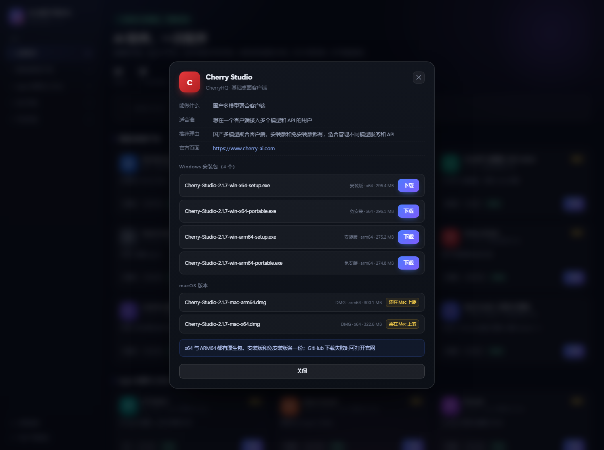

<p align="center">
  
</p>

<h1 align="center">📦 AI 客户端下载中心</h1>

<p align="center"><strong>Version 4.1</strong></p>

<p align="center">
  <em>一站式整理主流 AI 桌面客户端的官方下载地址，按电脑架构告诉您该装哪个版本。<br>
  Curated official download links for mainstream AI desktop clients, with per-architecture guidance.</em>
</p>

<p align="center">
  <a href="https://github.com/yanwaiyue-name/agent-download/stargazers"></a>
  <a href="https://github.com/yanwaiyue-name/agent-download/blob/master/LICENSE"></a>
  
  
</p>

<p align="center">
  <a href="README.md">中文</a> | <a href="README.en.md">English</a>
</p>

---

## 🚪 三种入口，选一个

| 你是 | 点这里 | 说明 |
| --- | --- | --- |
| **只想看看有哪些软件** | [🎯 在线清单](https://yanwaiyue-name.github.io/agent-download/%E6%B8%85%E5%8D%95.html) · [清单.html](清单.html) | 在线版开箱即看；单文件网页下载后双击即开，**不联网也能用** |
| **想让它自动下载安装** | 下载仓库 → 双击 `打开资源中心.bat` | 本地图形界面，按你的架构自动选包 |
| **完全没网** | 见下面「方式三：纯离线」 | 提前备好安装包，过去直接装 |

> 国内访问 GitHub 不稳定时，把仓库打包下载（Code → Download ZIP），解压后双击 `清单.html` 就能看完整清单。

---

## 这是什么

国内装 AI 客户端和命令行工具，通常卡在三件事：

1. **不知道去哪下** —— 搜索结果前几页全是"高速下载器"，装完一堆捆绑
2. **不知道下哪个版本** —— 同一款软件有 x64 / ARM64、安装版 / 免安装 / MSI，选错就白费
3. **下不动** —— 一部分官方源在国内直连超时

这个仓库做三件事：**整理官方地址**、**标注该装哪个版本**、**提供一个能自动检测本机并离线安装的工具**。

> 本仓库只包含**脚本和清单**，不含任何安装包本体。所有安装包请从下表官方地址获取。

---

## ⚡ 30 秒速查：您该装哪个

共 **43** 项，分 **8** 个分组。⭐ = 推荐。

> **重要**：标注 `npm` / `pip` 的工具**没有可双击的安装包**，必须用命令行安装。这是它们官方的发布方式，不是缺文件。

### 桌面端（10）

| 软件 | Intel/AMD | 骁龙/麒麟 | macOS | 官方地址 |
|---|---|---|---|---|
| **WorkBuddy（腾讯）** ⭐ | ✅ 安装版 | ⚠️ 模拟 | ✅ Apple | [官方页](https://www.workbuddy.cn) |
| **Claude Desktop** ⭐ | ✅ 安装版 | ⚠️ 模拟 | ✅ Apple/Intel | [官方页](https://claude.ai/download) |
| **ChatGPT 桌面端（含 Codex）** ⭐ | ✅ 商店 | ✅ 原生 | ✅ Apple/Intel | [官方页](https://chatgpt.com/download) |
| **OpenCode Desktop** ⭐ | ✅ 安装版/免安装 | ✅ 原生 | ✅ Apple/Intel | [官方页](https://opencode.ai/download) |
| **DeepSeek Harness 桌面版** | ✅ 安装版 | ⚠️ 模拟 | ✅ Apple/Intel | [官方页](https://github.com/anywhere-labs/dsh-desktop/releases) |
| **Cherry Studio** ⭐ | ✅ 安装版/免安装 | ✅ 原生 | ✅ Apple/Intel | [官方页](https://www.cherry-ai.com) |
| **LobeHub 桌面版** | ✅ 安装版 | ⚠️ 模拟 | ✅ Apple/Intel | [官方页](https://github.com/lobehub/lobehub/releases) |
| **Hermes Agent 桌面版** ⭐ | ✅ 安装版 | ⚠️ 模拟 | ✅ Apple | [官方页](https://hermes-agent.nousresearch.com/) |
| **Watt Toolkit（瓦特工具箱）** | ✅ 安装版/免安装 | ⚠️ 模拟 | ✅ Apple/Intel | [官方页](https://steampp.net/) |
| **ZCode 桌面版** ⭐ | ✅ 安装版 | ✅ 原生 | ✅ Apple/Intel | [官方页](https://zcode.z.ai/cn) |

### Agents（8）

| 软件 | Intel/AMD | 骁龙/麒麟 | macOS | 官方地址 |
|---|---|---|---|---|
| **CC Switch** ⭐ | ✅ 安装版/免安装 | ✅ 原生 | ✅ Apple/Intel | [官方页](https://ccswitch.io) |
| **Open Cowork** ⭐ | ✅ 安装版 | ⚠️ 模拟 | ✅ Apple | [官方页](https://github.com/OpenCoworkAI/open-cowork/releases) |
| **RunJam** ⭐ | ✅ 安装版 | ⚠️ 模拟 | ✅ Apple/Intel | [官方页](https://www.runjam.app) |
| **Desktop CC GUI** ⭐ | ✅ 安装版 | ⚠️ 模拟 | ✅ Apple/Intel | [官方页](https://github.com/zhukunpenglinyutong/desktop-cc-gui/releases) |
| **Goose** ⭐ | ✅ 安装版 | ⚠️ 模拟 | ✅ Apple/Intel | [官方页](https://github.com/aaif-goose/goose/releases) |
| **OpenHands** ⭐ | ✅ 安装版 | ⚠️ 模拟 | — | [官方页](https://github.com/OpenHands/OpenHands/releases) |
| **Cline（桌面版）** ⭐ | ✅ 安装版 | ⚠️ 模拟 | — | [官方页](https://github.com/cline/cline/releases) |
| **Grox（Grok Build 社区桌面版）** | ✅ 安装版 | ⚠️ 模拟 | — | [官方页](https://github.com/dandandujie/Grox) |

### IDE（6）

| 软件 | Intel/AMD | 骁龙/麒麟 | macOS | 官方地址 |
|---|---|---|---|---|
| **Cursor** ⭐ | 官网下载 | 官网下载 | 官网 | [官方页](https://cursor.com/downloads) |
| **Trae（国际版）** | 官网下载 | 官网下载 | 官网 | [官方页](https://www.trae.ai/download) |
| **Trae CN（国内版）** ⭐ | 官网下载 | 官网下载 | 官网 | [官方页](https://www.trae.cn/download) |
| **Windsurf** | 官网下载 | 官网下载 | 官网 | [官方页](https://windsurf.com/download) |
| **Visual Studio Code** | 官网下载 | 官网下载 | 官网 | [官方页](https://code.visualstudio.com/download) |
| **Qoder** ⭐ | 官网下载 | 官网下载 | 官网 | [官方页](https://qoder.com/en/download) |

### CLI Code（9）

| 软件 | Intel/AMD | 骁龙/麒麟 | macOS | 官方地址 |
|---|---|---|---|---|
| **Claude Code** ⭐ | ✅ 安装版/免安装 | ✅ 原生 | ✅ Apple/Intel | [官方页](https://github.com/anthropics/claude-code/releases) |
| **Gemini CLI** ⭐ | 官网下载 | ⚠️ 模拟 | ✅ Apple/Intel | [官方页](https://github.com/google-gemini/gemini-cli) |
| **Qwen Code** ⭐ | ✅ 安装版/免安装 | ⚠️ 模拟 | ✅ Apple/Intel | [官方页](https://github.com/QwenLM/qwen-code) |
| **Kimi CLI** ⭐ | ✅ 安装版/免安装 | ✅ 原生 | ✅ Apple/Intel | [官方页](https://github.com/MoonshotAI/kimi-cli/releases) |
| **Pi** ⭐ | ✅ 安装版/免安装 | ✅ 原生 | ✅ Apple/Intel | [官方页](https://github.com/earendil-works/pi) |
| **Codex CLI** | `npm` | `npm` | `npm` | [官方页](https://github.com/openai/codex) |
| **OpenClaw** ⭐ | `npm` | `npm` | `npm` | [官方页](https://github.com/openclaw/openclaw) |
| **Aider** | `pip` | `pip` | `pip` | [官方页](https://aider.chat/docs/install.html) |
| **iFlow CLI** | `npm` | `npm` | `npm` | [官方页](https://github.com/iflow-ai/iflow-cli) |

### 运行环境（3）

| 名称 | 说明 | 官方地址 |
|---|---|---|
| **WebView2 运行时（在线版）** | 网页渲染内核，1.8 MB 引导器（安装时要联网） | [官方页](https://developer.microsoft.com/microsoft-edge/webview2/) |
| **WebView2 运行时（离线包）** | 完整离线安装包，装的时候不需要联网 | [官方页](https://developer.microsoft.com/microsoft-edge/webview2/) |
| **VC++ 运行库 2015-2022（x64）** | 微软 Visual C++ 运行库，多数桌面软件的底层依赖 | [官方页](https://learn.microsoft.com/cpp/windows/latest-supported-vc-redist) |

### 开发环境（4）

| 名称 | 说明 | 官方地址 |
|---|---|---|
| **Python 3.13.10** | Python 官方解释器（含 pip） | [官方页](https://www.python.org/downloads/windows/) |
| **Node.js 24.22.1 LTS** | Node.js 长期支持版（含 npm） | [官方页](https://nodejs.org/zh-cn/download) |
| **Git for Windows 2.56.0.3** | Git 版本控制（含 Git Bash） | [官方页](https://git-scm.com/download/win) |
| **7-Zip 25.01** | 开源压缩工具，支持 .7z / .zip / .rar 等 | [官方页](https://www.7-zip.org/) |

### 本地运行（2）

在自己电脑上跑开源模型（Qwen / DeepSeek / Llama 等），不走云端 API。

| 软件 | Intel/AMD | 骁龙/麒麟 | macOS | 官方地址 |
|---|---|---|---|---|
| **Ollama** ⭐ | ✅ 安装版（1.5 GB） | ✅ zip | ✅ Apple/Intel | [官方页](https://ollama.com/download) |
| **LM Studio** ⭐ | 官网下载 | 官网下载 | 官网 | [官方页](https://lmstudio.ai/download) |

### 实用工具（1）

不是 AI 软件，但能让上面的东西下载得更快。

| 软件 | Intel/AMD | 骁龙/麒麟 | macOS | 官方地址 |
|---|---|---|---|---|
| **Motrix** ⭐ | ✅ 安装版 | ✅ 原生 | ✅ Apple/Intel | [官方页](https://motrix.app) |


---

## 🤔 不知道自己是什么电脑？

| 看到这个 | 说明 | 该怎么办 |
|---|---|---|
| Intel Core / AMD Ryzen | 普通 **x64** 电脑，占九成 | 下 x64 版本 |
| 骁龙 X / 麒麟 / 天玑 | **ARM64** 电脑 | 优先下 ARM64 原生版；没有原生版时选 x64（系统会模拟运行，慢一点） |
| Apple M1 / M2 / M3 / M4 | **Apple Silicon** | 下 macOS arm64 的 dmg |
| Apple Intel（2020 年前） | **Intel Mac** | 下 macOS x64 的 dmg |

**不想查？** 在 Windows 上双击仓库里的 `双击检测.bat`，它会直接告诉你该装哪个版本，并生成一份可分享的 `本机检测报告.txt`。

手动查也行：`Win + R` → 输入 `msinfo32` → 看「系统类型」那一行。

---

## 🚀 三种用法

### 方式一：图形界面（推荐新手）

双击 **`打开资源中心.bat`**，浏览器会打开一个本地软件目录页：

- 每款软件一张卡片：图标、简介、大小、「已就位」标记
- 左侧按分类筛选，顶部搜索框，x64 / ARM64 一键切换
- 点「下载」直接保存，支持暂停和续传
- 页面只在 `127.0.0.1` 本地运行，**不联网、不上传数据、不需要管理员权限**

<p align="center">
  
</p>

### 方式二：命令行

双击 **`双击启动.bat`**，在窗口里输序号安装。`A` 下载全部默认格式，`V` 校验本地安装包完整性，`Q` 退出。

### 方式三：纯离线（无网络环境）

1. 在有网的机器上把安装包下载好，按 `安装包/<软件名>/` 的结构放进去
2. 整个文件夹拷到目标机器
3. 双击 `双击启动.bat` —— 全部显示「已就绪」，点一下直接装，**全程不联网**

`sources.json` 里每个应用都标了 `dir` 字段，就是文件夹名。放错位置会认不出来。

---

## 🇨🇳 国内网络现实

| 情况 | 说明 |
|---|---|
| 腾讯系（WorkBuddy）、微软、GitHub 加速站 | 国内直连可用 |
| `downloads.claude.ai`、`hermes-assets.nousresearch.com` | 直连不稳，需要代理 |
| GitHub Releases | 国内直连基本不通，工具内置了加速站回退 |
| ChatGPT / Codex | Windows 版只有微软商店引导器，**装的时候仍要联网** |

工具里对 GitHub 直链会自动依次尝试加速前缀，无需手动配置。

---

## 📁 仓库结构

```
agent-download/
├── README.md                    本文件
├── README.en.md                 英文版
├── 双击启动.bat                 命令行安装器（小白入口）
├── 双击检测.bat                 本机架构检测
├── 打开资源中心.bat             图形界面入口
├── launcher.ps1                 安装主逻辑
├── check-pc.ps1                 系统检测逻辑
├── 资源中心服务.ps1             本地 HTTP 服务（127.0.0.1）
├── 资源中心.html                目录页界面
├── sources.json                 ★ 唯一数据源：38 个应用的地址和版本
├── 使用说明.txt                 给使用者的操作说明
├── 软件推荐与官方下载地址.txt    推荐表和官网直链
├── docs/
│   ├── MAINTAINER.md            维护指南（改 sources.json / 加应用 / 打包）
│   ├── DOWNLOAD-LINKS.md        全部官方直链与校验方法
│   └── images/                  界面截图
└── scripts/
    ├── 更新.ps1                 一键 校验+提交+推送
    ├── verify.ps1               校验 sources.json 与所有脚本
    ├── check-links.ps1          直链健康检查（需 pwsh 7）
    ├── 打包.ps1                 生成发布包
    ├── gen-dirs.ps1             按 JSON 重建安装包目录
    ├── 补全安装包.ps1           批量下载全部格式
    └── 清理.ps1                 清理可再生产物
```

---

## 🔧 想自己加一个软件？

只改 `sources.json` 的 `apps` 数组，加一条就行：

```json
{
  "id": "my-app",
  "name": "我的软件",
  "group": "基础桌面客户端",
  "desc": "一句话说明",
  "dir": "MyApp",
  "arch": "both",
  "variants": [
    { "arch": "x64",   "format": "setup", "file": "MyApp-x64.exe",   "size": "120 MB", "urls": ["https://example.com/MyApp-x64.exe"] },
    { "arch": "arm64", "format": "setup", "file": "MyApp-arm64.exe", "size": "118 MB", "urls": ["https://example.com/MyApp-arm64.exe"] }
  ],
  "page": "https://example.com/download",
  "tip": "装完要重启"
}
```

然后跑 `scripts/gen-dirs.ps1 -Force` 建好文件夹。详细字段说明见 [docs/MAINTAINER.md](docs/MAINTAINER.md)。

---

## 🔄 改完怎么发布

不要手动 `git add` + `commit` + `push`，用一条命令：

```powershell
powershell -ExecutionPolicy Bypass -File .\scripts\更新.ps1 -Message "更新 Claude 到 v2.x"
```

它按顺序做四件事，任何一步失败就停下，不会把坏数据推上去：

| 步骤 | 做什么 |
| --- | --- |
| 1 | 校验 `sources.json` 与所有脚本（`verify.ps1`），出错立即中止 |
| 2 | `git add -A` |
| 3 | `git commit`（用你给的 -Message） |
| 4 | `git push` 当前分支（需要代理时加 `-Proxy` 参数；`:443` 地址可绕开镜像改写） |

改了 `sources.json` 想顺便重建目录结构，加 `-Regen`：

```powershell
.\scripts\更新.ps1 -Message "新增 XX 软件" -Regen
```

只想在本地提交、暂不推送，加 `-Push:$false`。

⚠️ 不要给不存在的架构/格式编 variant —— 官方没发 portable 就别写，写上去只会让使用者 404。

---

## ⚠️ 已知限制

| 限制 | 说明 |
|---|---|
| 部分直链带版本号 | WorkBuddy / Claude / ChatGPT 的直链含版本哈希，新版发布后旧链接失效。**建议优先用「官方页」链接** |
| Claude / Hermes 需代理 | 官方 CDN 在国内直连不稳 |
| Codex 的 exe 只有 813 KB | 是微软商店引导器，双击后还要联网拉主程序 |
| Hermes 的 exe 只有 7.6 MB | 同样是引导器，首次启动联网拉运行时 |
| 安装包无微软签名 | Windows 会显示 SmartScreen 警告，属正常现象 |
| macOS 包不在 Windows 包里 | dmg 单独放，Windows 启动器不读 |

---

## 📄 说明

- 本仓库**不含任何安装包本体**，仅整理官方下载地址并提供下载/安装便利
- 所有安装包版权归各厂商所有，请从官方渠道获取并遵守其许可协议
- 建议安装前核对文件名与发布者，确认来自官方页面
- 部分软件在中国大陆需网络代理才能访问官方源

## License

[MIT](LICENSE) —— 脚本和清单部分可自由使用、修改、分发。

---

<p align="center"><em>如果这个清单帮你少踩了坑，点个 ⭐ Star，让后来的人也能找到它。</em></p>

## 相关项目

- [dsh-purge](https://github.com/yanwaiyue-name/dsh-purge) —— DeepSeek Harness 红队插件
- [haiou2.0-Claude-Code-](https://github.com/yanwaiyue-name/haiou2.0-Claude-Code-) —— Claude Code 人格配置包